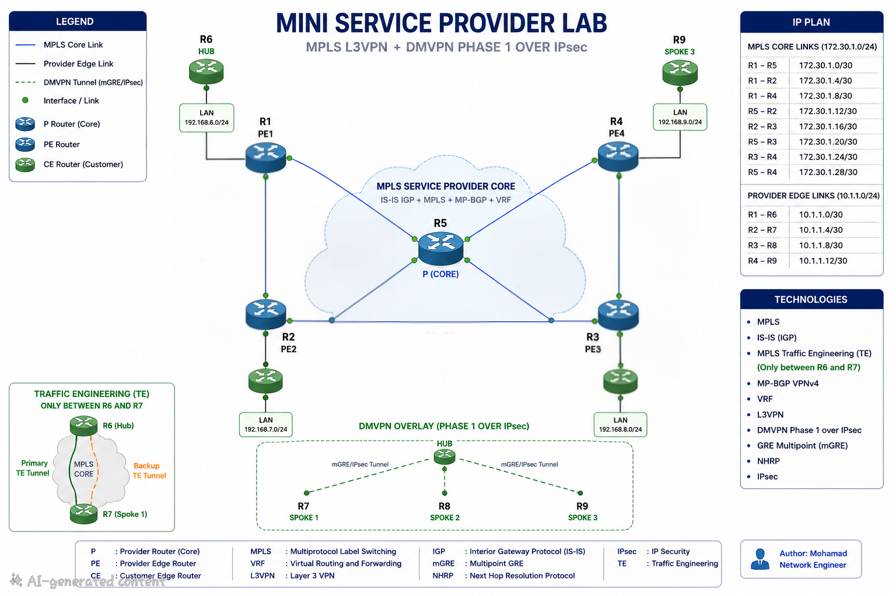

# Mini Service Provider Lab

A hands-on Cisco IOSv lab that simulates a real-world Service Provider network with MPLS, Traffic Engineering, L3VPN services, and secure customer connectivity using DMVPN Phase 1 over IPsec.

---

## Network Overview

This lab was designed to simulate a Service Provider environment and practice technologies commonly deployed in ISP networks.

The Service Provider core provides MPLS Layer 3 VPN services, while customer sites communicate securely using a DMVPN Phase 1 over IPsec overlay.

The complete lab infrastructure runs on **KVM virtualization over Ubuntu Linux**, where Cisco IOSv routers are deployed as virtual network devices.

---

# Topology

<p align="center">
  
</p>

## Service Provider

- 1 × P Router
- 4 × PE Routers

## Customer Network

- 1 × Hub Router
- 3 × Spoke Routers

---

# Technologies

## Service Provider

- MPLS
- IS-IS IGP
- MPLS Traffic Engineering (MPLS TE)
- RSVP-TE
- MP-BGP VPNv4
- VRF
- MPLS Layer 3 VPN

## Customer Network

- DMVPN Phase 1
- GRE Multipoint Tunnel
- NHRP
- IPsec

---

# Lab Features

- Service Provider MPLS Backbone
- IS-IS Based Core Routing
- MPLS Label Switching
- MPLS Traffic Engineering
- MP-BGP VPNv4 Route Exchange
- VRF-Based Customer Isolation
- Secure DMVPN Overlay
- IPsec Protected Customer Connectivity
- End-to-End Customer Communication

---

# Virtualization Platform

The lab is built using:

- Ubuntu Linux
- KVM / QEMU
- Libvirt
- Cisco IOSv Images

All routers are running as virtual machines on KVM virtualization.

The virtual network topology is created using Linux bridges and managed through Libvirt.

---

# Repository Structure

```
mini-sp-lab/
│
├── README.md
│
├── configs/
│   │
│   ├── SP/
│   │   ├── P/
│   │   ├── PE1/
│   │   ├── PE2/
│   │   ├── PE3/
│   │   └── PE4/
│   │
│   └── Customer/
│       ├── HUB/
│       ├── SPOKE1/
│       ├── SPOKE2/
│       └── SPOKE3/
│
├── topology/
│   └── topology.png
│
└── screenshots/
    │
    ├── isis-neighbors.png
    ├── mpls-forwarding.png
    ├── mpls-te.png
    ├── bgp-vpnv4.png
    ├── vrf-routing.png
    ├── dmvpn.png
    ├── nhrp.png
    ├── ipsec-sa.png
    └── ping-test.png
```

---

# Verification

The project includes verification outputs for:

- IS-IS Neighbor Adjacencies
- MPLS Label Forwarding
- MPLS Traffic Engineering Tunnel Status
- MP-BGP VPNv4 Sessions
- VRF Routing Tables
- DMVPN Tunnel Status
- NHRP Registration
- IPsec Security Associations
- End-to-End Customer Connectivity Tests

---

# Example Validation Commands

```bash
show isis neighbors

show mpls forwarding-table

show mpls traffic-eng tunnels

show bgp vpnv4 unicast all

show ip vrf

show dmvpn

show ip nhrp

show crypto ipsec sa

ping vrf <customer-vrf> <destination>
```

---

# Platform

## Network Devices

- Cisco IOSv Routers

## Virtualization

- Ubuntu Linux
- KVM/QEMU
- Libvirt

## Lab Environment

- Virtual Service Provider Network
- Virtual Customer Sites
- MPLS Core Simulation

---

# Future Improvements

- EVPN
- VXLAN
- BGP PIC
- MPLS Fast Reroute
- BFD Integration
- Network Automation using Ansible
- Monitoring with Zabbix
- Configuration Management

---

# Author

**Mohamad**

Network Engineer

Interested in:

- Service Provider Networks
- MPLS / L3VPN
- Traffic Engineering
- DMVPN & Secure Overlay Networks
- Network Automation
